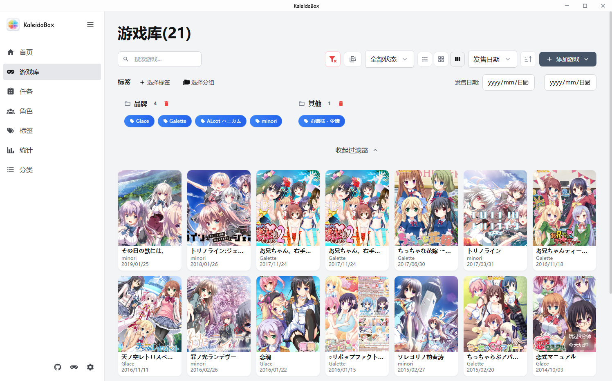
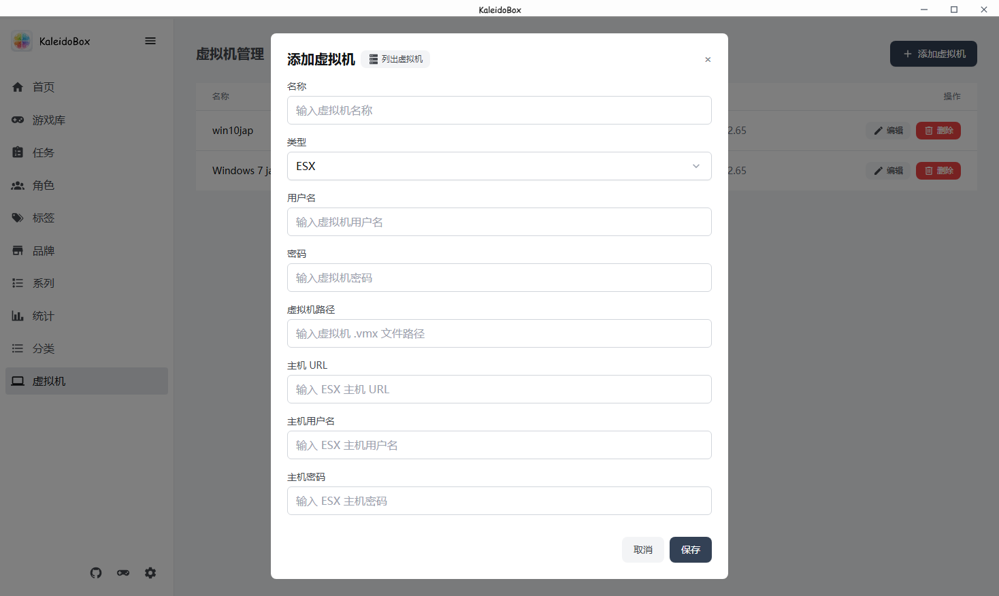

# 游戏库与导入

## 游戏库

游戏库是管理所有游戏的核心页面，支持四种显示模式：

- **列表模式** —— 紧凑列表，可直接看到游玩时间
- **小图模式**
- **大图模式**
- **画廊模式** —— 直接在卡片上浏览游戏图片

点击游戏卡片进入游戏详情页，可以查看/编辑游戏信息、启动游戏、管理备份等：

## 导入游戏

### 批量添加

支持多种导入方式：

- **文件夹批量导入** —— 直接扫描游戏目录
- **快捷方式文件夹导入** —— 推荐方式。游戏文件夹名大多不含准确的游戏名，通过快捷方式（.lnk）能拿到更准确的游戏名，且支持特殊字符；有些游戏是在快捷方式里联动破解的，单纯启动 exe 不够，这种方式也支持
- **拖拽导入** —— 把文件/文件夹拖入窗口

### 特殊类型的游戏

- **.htm / .html 游戏** —— 启动时会自动开启 HTTP 服务器，解决浏览器的本地文件限制
- **Steam 游戏** —— 在游戏参数里填入 `steam://` 链接，会用 Steam 启动
- **虚拟机游戏** —— 支持启动同目录下的虚拟机游戏，支持多虚拟机管理和 ESX，见 [设置详解](09-设置详解.md#虚拟机)

## 启动游戏

- 点击游戏卡片或详情页的启动按钮即可启动
- 支持选择输出屏幕（统一游戏的输出屏幕）
- 支持通过 Locale Emulator（转区）和 Magpie（放大）启动，可在游戏详情里按游戏单独设置
- 启动后会自动记录游玩时长，支持仅记录前台活跃时间（见 [设置详解](09-设置详解.md#通用)）
- 支持手柄键位映射与触摸映射，见 [设置详解](09-设置详解.md#键位映射)

## 下一步

游戏添加后，建议先 [搜刮元数据](03-元数据搜刮.md) 补全信息。
