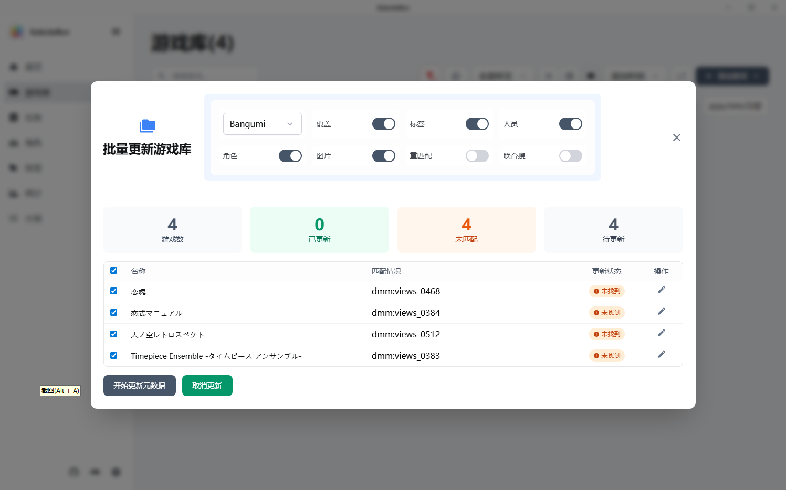
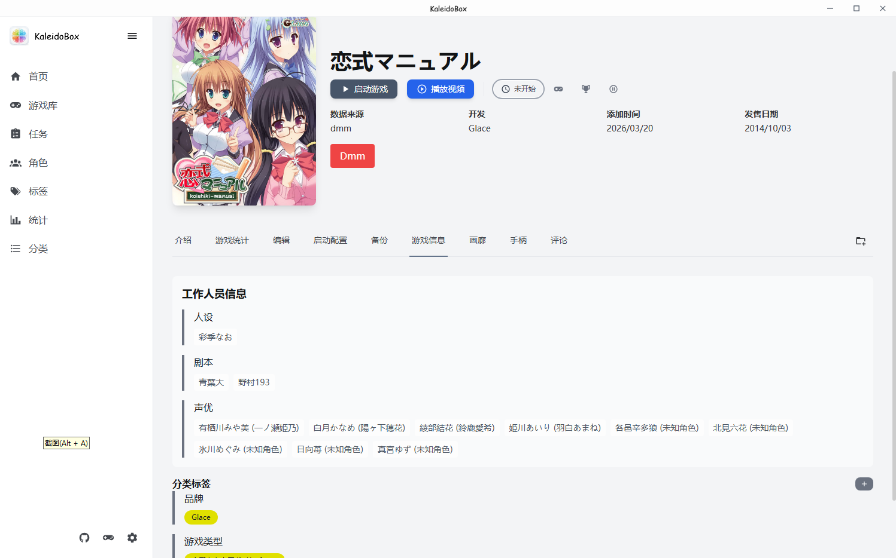

# 元数据搜刮

## 支持的数据源

| 数据源 | 方式 | 说明 |
|--------|------|------|
| 批评空间（Erogamescape） | 爬虫 | 主力源，标签分类体系以此为准 |
| DMM PC 游戏 | 爬虫 | 部分 DMM 专属排版的游戏可能拿不到正确数据 |
| Getchu | 爬虫 | 部分游戏有专属排版；不开启自动下载图片时看不到图 |
| DLSITE | 爬虫 | 支持 pro 和 maniax |
| Bangumi | API | 需要 Token，评论失败时先更新 Token |
| VNDB | API | 需要 Token |
| 月幕 gal（Ymgal） | API | |
| Hikarinagi | API | 需在设置中完成 OAuth 授权，未授权时会弹窗引导；支持评论查看 |
| Kungal | 网页解析 | 按条目 ID 抓取完整信息（标题/简介/角色/声优/staff/标签），无匿名搜索接口 |

## 搜刮方式

### 批量搜刮更新（推荐）

先添加游戏，再批量搜刮更新数据。搜刮更新在**后台任务**中执行，可适配超大量搜刮，进度和结果在任务页查看。

- 同时搜几个源会使数据混乱，不推荐；分批次搜没问题
- 支持**选择需要的数据**（是否拉取角色、staff、标签、图片等）
- **重匹配**：重新按名字搜索数据，即使已有源匹配 ID；否则有 ID 时直接从详情页拉数据

### 联合搜刮

主要给批评空间用：源为批评空间时，能同时获得 dlsite、dmm、getchu 的 ID。批评空间本身没有游戏介绍，拿到这些 ID 后就能再从这些源搜刮一次。

### 来源 ID 管理

- 每个游戏维护一份来源列表（如 `bangumi:301984;dmm:d_149252`），搜刮时从各来源的外部链接**自动提取**其他源的 ID 存入来源列表，已有 ID 不会被覆盖
- 在批量更新弹窗点击来源单元格，可弹窗**编辑各来源 ID**：输入 ID → 搜刮 → 以卡片预览 → 确认入库；每行也有删除按钮可清空该源 ID
- Hikarinagi 未授权时只有用户主动操作才弹"去授权"，后台批量任务会静默跳过

## 「优先获取中文信息」开关

设置中的 **SearchCn** 开关控制搜刮结果优先显示译名/中文简介还是原文。开关关闭时显示原文标题与简介。

## 游戏详情页信息

搜刮完成后，游戏详情页会展示：

- 标题、发售日、公司、封面
- 故事简介、人物、关联游戏

- 工作人员（staff）与标签

## 下一步

- 搜刮到的标签如何使用，见 [分类与标签](04-分类与标签.md)
- 各源评论查看，见 [评论与攻略](06-评论与攻略.md)
