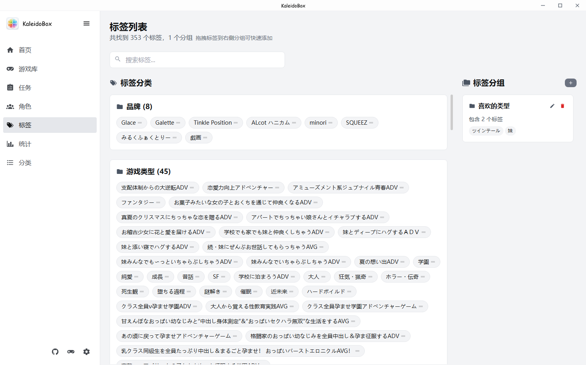

# 分类与标签

## 标签体系

标签主要依据**批评空间的分类标签**建立。其他数据源的标签除品牌和类型有专门分类外，其余都会归入"其他"。

内置标签分类包括：

- **类型**（Genre）—— 搜刮时自动分配
- **品牌**（Company）—— 可直接用标签过滤游戏，不再单设品牌过滤器
- **系列** —— 游戏系列有专门标签分类
- **自定义分组** —— 自己创建的标签分组，用于个人整理

## 过滤器

在过滤器中添加标签时，多个标签之间是 **OR**（任一命中即显示）关系。

游戏的很多属性过滤（如品牌）不再使用专门的过滤器，直接通过标签分类完成。

## 分类页

分类页能从多种维度归类浏览游戏：

- 品牌
- 系列
- 收藏
- 类型
- 人设
- 剧本
- 父目录

分类页同样支持**画廊模式**浏览。

## 下一步

- [画廊模式与截图](05-画廊与截图.md)
