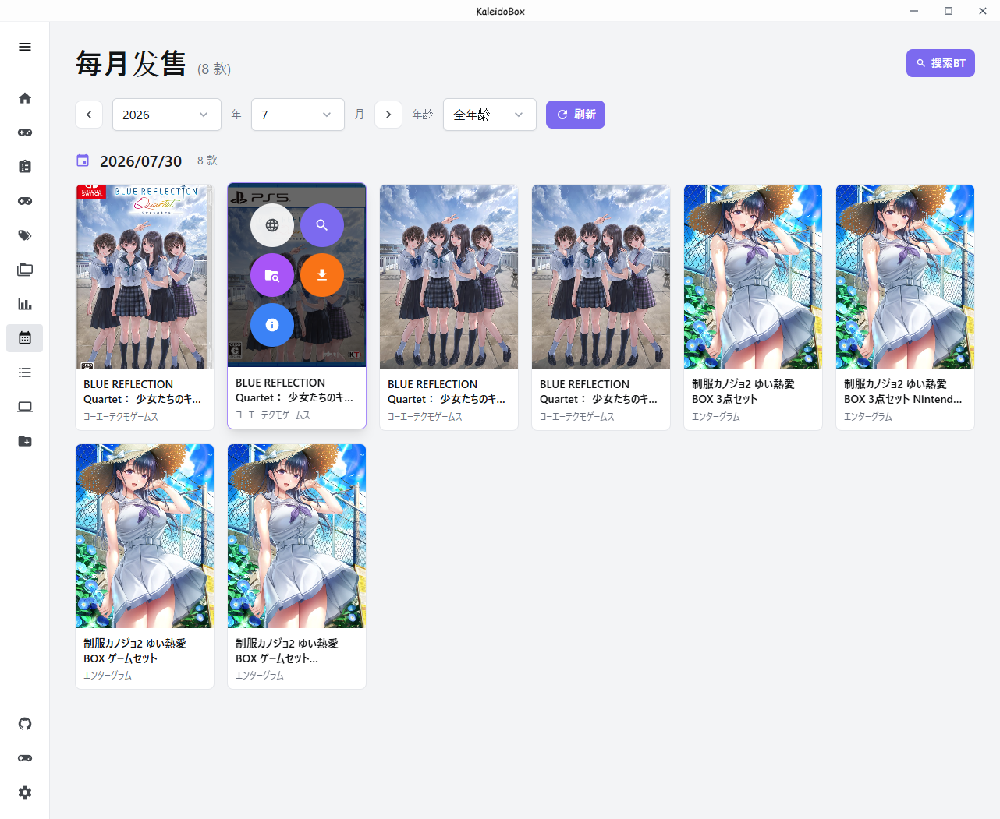
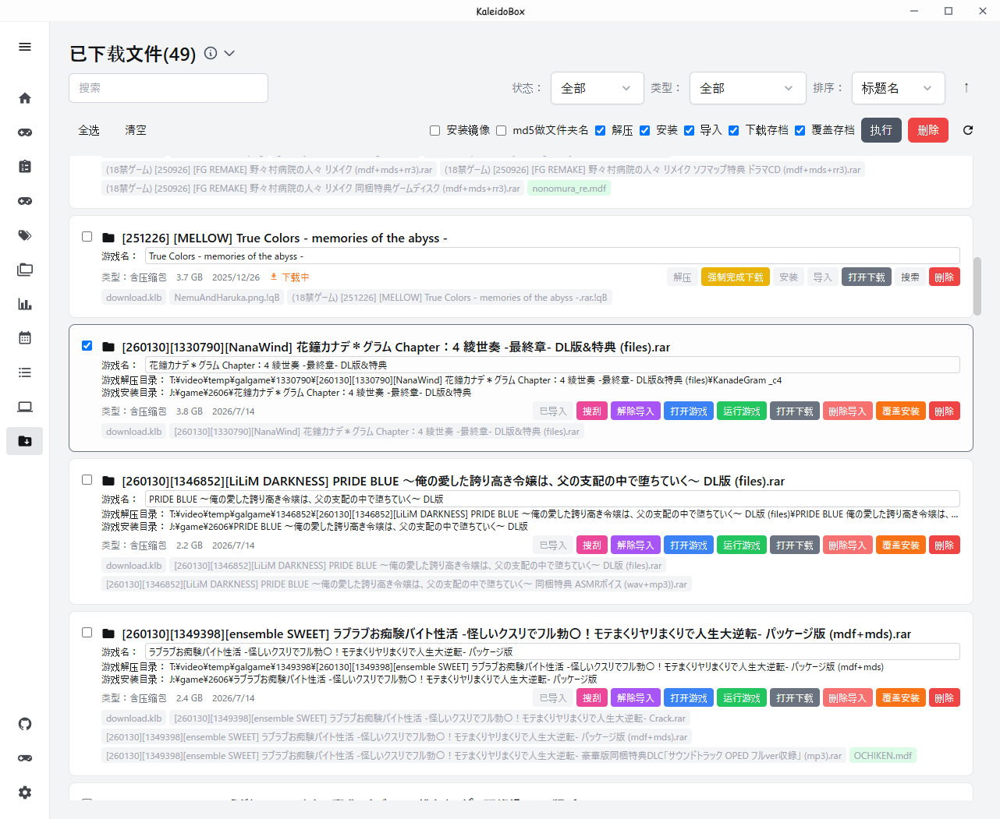

# 下载与资源

## 游戏资源页

- 查看来自 **Getchu 的每月游戏**（已导入且有 Getchu ID 的游戏会标示）
- 搜索 **nyaa** 的 BT 资源（RSS 源可在设置中修改；出于合规考虑，之后可能不预置 nyaa，需要自己填写）
- 发送 BT 下载任务到 **qBittorrent** 服务器
- 能看到资源是否已导入或已在下载

## qBittorrent 集成

在设置中配置 qBittorrent 服务器地址后即可发送下载任务。

> **提示**：qBittorrent 请设置"打开为完成文件挂上 `.!qb` 后缀"的功能，用来检查是否完成下载。

## 已下载文件页

管理下载文件夹，支持批量操作：

- 批量解压
- 批量安装
- 批量导入到游戏库
- 批量下载存档
- 批量删除

> **注意**：官方安装方式的游戏无法完成全流程批量处理，但已能省下大量时间。

## 下一步

- 下载完成后回到 [游戏库与导入](02-游戏库与导入.md) 导入游戏
