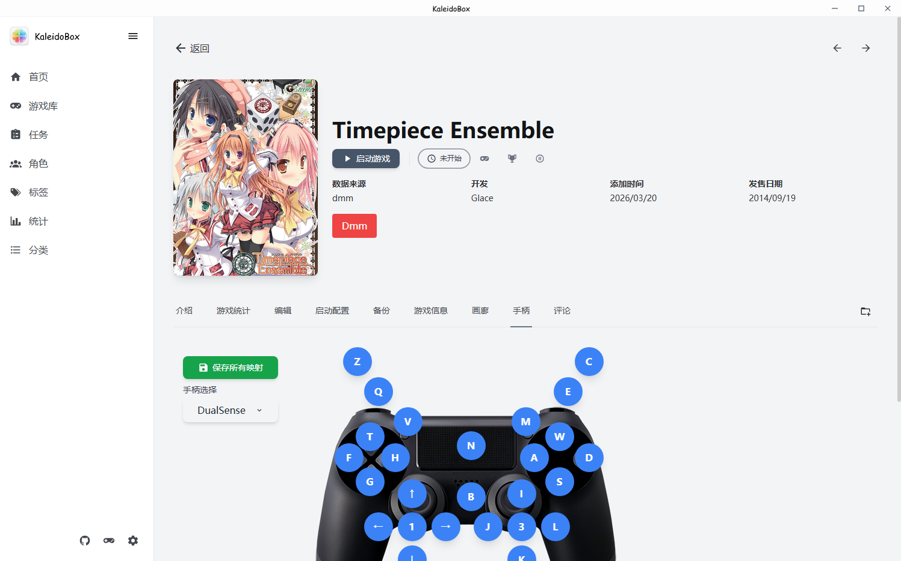

# 设置详解

设置按面板分组，以下按面板说明主要配置项。

## 通用

- **优先获取中文信息（SearchCn）** —— 开启后搜刮结果优先显示译名/中文简介；关闭显示原文（见 [元数据搜刮](03-元数据搜刮.md)）
- **仅记录活跃游玩时长** —— 只在窗口前台时记录游玩时间
- **启动时检查更新** —— 可自定义更新检查 URL、跳过指定版本

## 备份

详细说明见 [存档与云备份](07-存档与云备份.md)。

| 配置项 | 说明 |
|--------|------|
| 启用云备份 | 云备份总开关 |
| 云备份提供商 | S3 / OneDrive / WebDAV |
| 游戏退出时自动备份存档 | 需先设置存档位置 |
| 自动上传数据库备份到云端 | 需先启用云备份 |
| 自动上传游戏存档备份到云端 | 需先启用云备份 |
| **启动前自动同步云端存档** | 启动游戏前检测并恢复较新的云端存档（1.4.0 新增） |
| 本地/云端备份保留数量 | 超出自动清理 |

- **备份密码** —— 用于生成云端用户标识（BackupUserID）与加密

## Hikarinagi 授权

- 应用内 OAuth 授权（授权码 + PKCE 流程），未授权时需要授权的操作会弹窗引导
- 授权后支持搜刮与评论查看；后台批量任务在未授权时静默跳过

## 手柄

支持全局手柄设置与单独游戏设置：

- DualSense 需要 USB 连接；DS4 可蓝牙连接；NS Pro 可蓝牙连接但需要安装 BetterJoy 驱动；XInput 设备直连
- 已测试所有常见手柄

## 键位映射

- 支持**手柄映射**与**触摸映射**（供 Windows 平板游玩，启动游戏时显示在屏幕上）
- **截图键**只能设置全局，支持手柄截图键
- 启动映射需要设置好**进程名**；自动检测需等待检测完成，可在游玩配置里设置检测时间

## 虚拟机

- 支持启动同目录下的虚拟机游戏，映射盘也可
- 支持多虚拟机管理与 ESX
- ESX 音频问题可用 [VBAN](https://vb-audio.com/Voicemeeter/vban.htm) 解决

## 视频播放

- 支持视频播放，`ffmpeg.exe` 放在程序目录下或自行设置路径
- 显卡驱动需与 ffmpeg 版本兼容
- 通过搜索视频来播放

## 游玩配置

- 游戏进程检测时间（配合键位映射自动启用）
- Locale Emulator / Magpie 默认值
