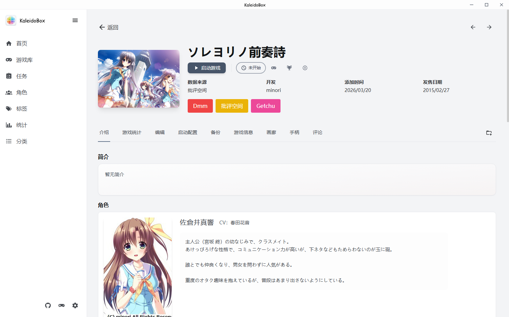

# KaleidoBox 用户手册

**轻量、快速、功能丰富的视觉小说管理与游玩统计工具**

欢迎阅读 KaleidoBox 用户手册。手册按功能模块分页，可从目录直接跳转。

## 手册目录

| 章节 | 内容 |
|------|------|
| [快速开始](01-快速开始.md) | 安装、首次启动、界面总览、添加第一个游戏 |
| [游戏库与导入](02-游戏库与导入.md) | 批量导入、文件夹扫描、快捷方式导入、显示模式、启动游戏 |
| [元数据搜刮](03-元数据搜刮.md) | 数据源介绍、批量搜刮更新、来源 ID 管理、混合搜刮 |
| [分类与标签](04-分类与标签.md) | 标签分类体系、过滤器、自定义分组、分类页 |
| [画廊与截图](05-画廊与截图.md) | 官方图片下载、游戏内截图、画廊模式、图片查看器 |
| [评论与攻略](06-评论与攻略.md) | 各源评论与评分查看、攻略板块 |
| [存档与云备份](07-存档与云备份.md) | 本地备份、云备份配置（S3/OneDrive/WebDAV）、存档云同步、存档下载 |
| [下载与资源](08-下载与资源.md) | 游戏资源页、qBittorrent 集成、已下载文件批量处理 |
| [设置详解](09-设置详解.md) | 各设置项说明：通用、备份、手柄、键位映射、虚拟机等 |
| [CLI 命令行](10-CLI命令行.md) | kaleidocli 命令参考 |
| [常见问题](11-常见问题.md) | 搜刮失败、授权问题、备份恢复等 FAQ |

## 截图速览

## 获得帮助

- 提交 [Issue](https://github.com/gza21aliyun/kaleidobox/issues)
- 项目主页：[GitHub 仓库](https://github.com/gza21aliyun/kaleidobox)
